# Teste Caixa Cinza em API de Autenticação com Supabase e Postman

**Aluno:** Victor Akimoto Ferreira
**RA:** 264396
**Componente curricular:** UX/UI e Testes de Software (AS406TSN1)
**Data de execução dos testes:** 06/11/2026

---

# Introdução

Este repositório documenta a atividade **Teste Caixa Cinza com Supabase e Postman**. Nela, montei um ambiente de autenticação por e-mail e senha no **Supabase** e executei testes funcionais sobre a API de login usando o **Postman Desktop**.

Um teste de **caixa cinza** é aquele em que o testador conhece parte da estrutura do sistema, mas não o código-fonte. Neste caso, eu conhecia o endpoint, o método HTTP, os headers, o formato do body JSON e os códigos de resposta, e validei o comportamento da API a partir dessas informações.

Nenhuma interface gráfica foi desenvolvida. Toda a validação foi feita diretamente sobre as requisições HTTP.

**Estrutura do repositório**

```
/README.md
/postman/    → collection e environment exportados do Postman
/prints/     → evidências (capturas de tela)
/planilha/   → planilha de registro dos testes
```

---

# Objetivo da Atividade

Compreender e aplicar testes de caixa cinza em APIs de autenticação, usando ferramentas de mercado para configuração, execução e validação de testes funcionais. Na atividade, eu:

- configurei um ambiente de autenticação no Supabase;
- criei um usuário para testes;
- estudei o funcionamento de requisições HTTP;
- utilizei o Postman para executar os testes;
- validei as respostas de autenticação (status HTTP, JSON, mensagens de erro e access token);
- documentei todo o processo neste README.

---

# Configuração do Supabase

## Como o projeto foi criado

Criei uma conta no Supabase (https://supabase.com) vinculada ao meu GitHub, e em seguida um novo projeto chamado **`teste-caixa-cinza`**, no plano **Free**, com a região **South America (São Paulo)**. A infraestrutura do servidor é gerenciada pela própria plataforma.

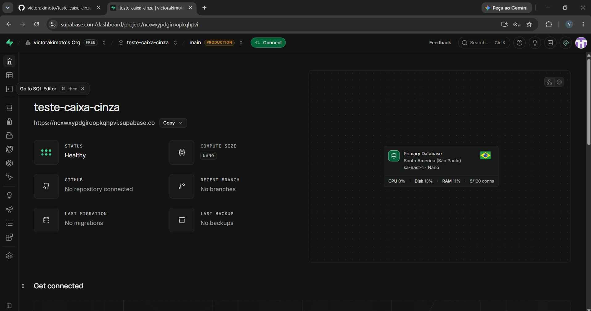

## Tipo de autenticação utilizada

Utilizei a autenticação por **e-mail e senha**. Em **Authentication → Sign In / Providers**, confirmei que o provedor **Email** está **Enabled**. Deixei a opção **Confirm email** **desativada**, para que o usuário de teste possa entrar sem precisar confirmar o endereço por e-mail.

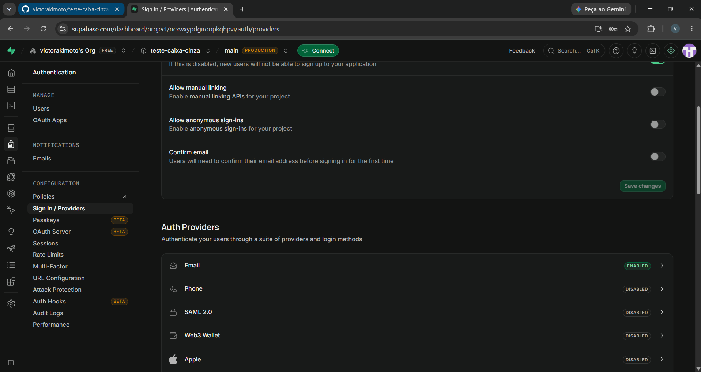

## Como o usuário foi criado

Em **Authentication → Users**, usei o botão **Add user** para cadastrar o usuário de teste `teste123@gmail.com`, com uma senha definida por mim. A senha não é divulgada neste repositório.

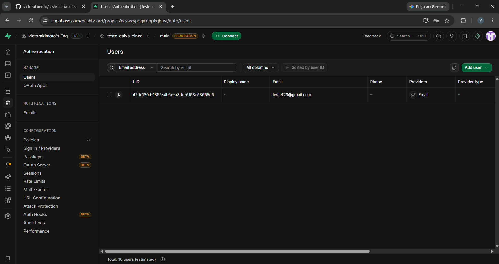

## Credenciais da API

Obtive a **API URL** e a **API KEY** nas configurações do projeto:

| Item | Valor |
|---|---|
| API URL (`base_url`) | `https://ncxwxypdgiroopkqhpvi.supabase.co` |
| API KEY (`api_key`) | chave `anon public` (começa com `eyJ...`) |

Foi usada apenas a chave `anon` (pública). A chave `service_role` não foi utilizada nem exposta.

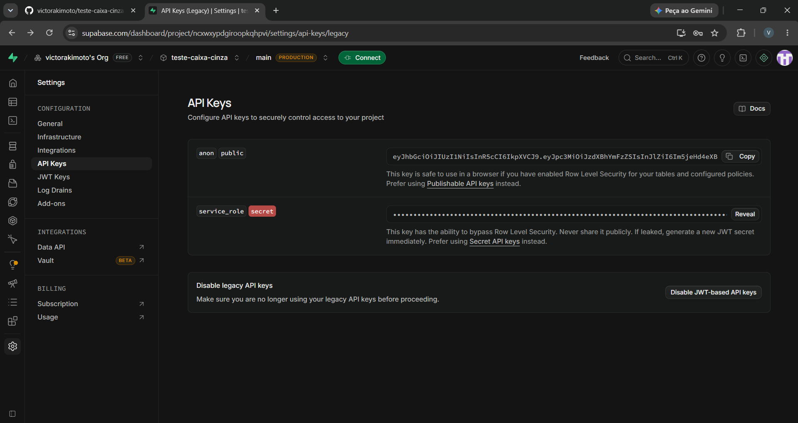

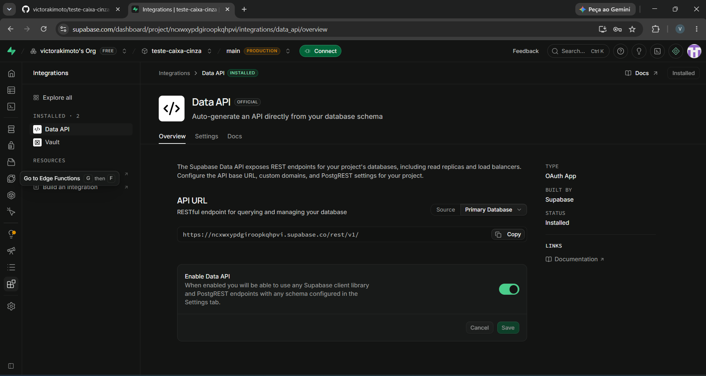

O endereço mostrado na tela **Data API** termina em `/rest/v1/`. Na `base_url` usei somente a parte inicial, sem esse trecho, porque a autenticação usa o caminho `/auth/v1/`.

## Identificação do aluno

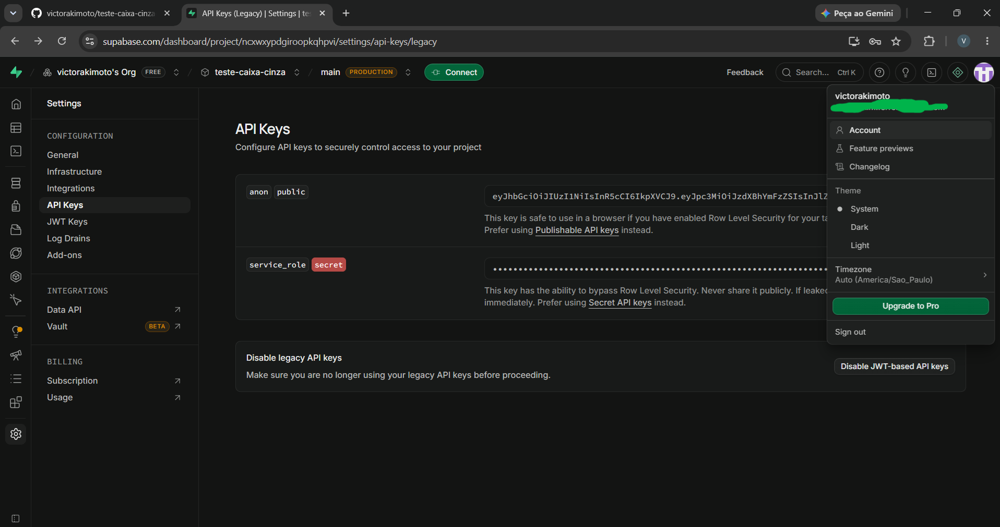

## Objetivo da configuração

Ter um serviço real de autenticação, com um usuário cadastrado, para que os testes de API verificassem se o login aceita credenciais válidas e rejeita as inválidas.

---

# Configuração do Postman

## Workspace

Instalei o **Postman Desktop** e criei o workspace **Teste Caixa Cinza Supabase**, a partir do menu **Workspaces**.

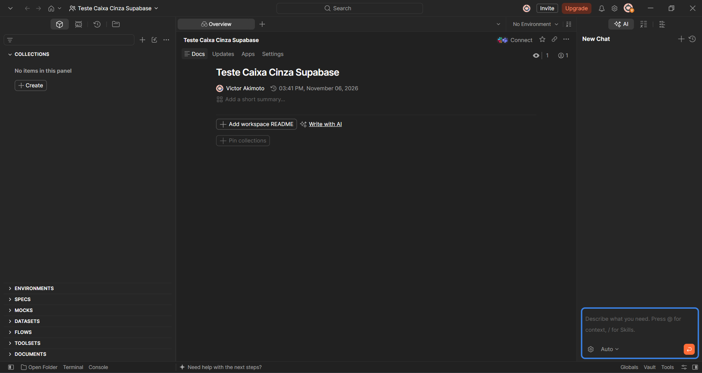

## Environment

Criei o Environment **Supabase Env** e ativei-o no canto superior direito da janela. Configurei as quatro variáveis abaixo:

| Variável | Descrição | Valor |
|---|---|---|
| `base_url` | URL da API do Supabase | `https://ncxwxypdgiroopkqhpvi.supabase.co` |
| `api_key` | API KEY (chave `anon`) | chave `anon public` |
| `email` | Usuário criado no Supabase | `teste123@gmail.com` |
| `password` | Senha criada | definida no Environment (omitida aqui) |

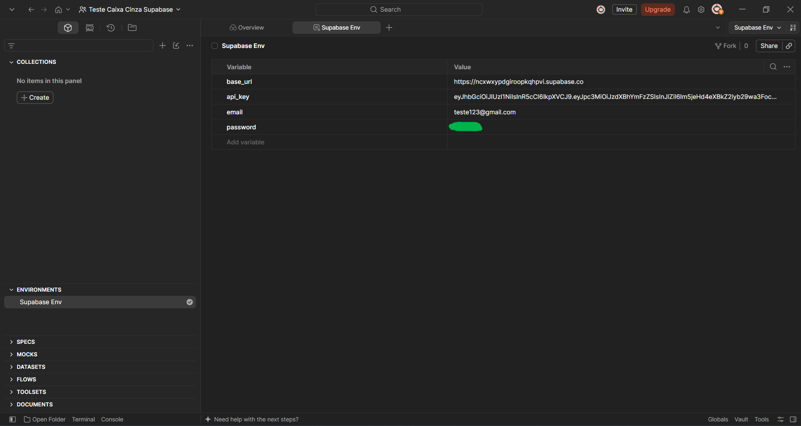

## Finalidade das variáveis

Elas evitam repetir dados em cada requisição. A URL, a chave e as credenciais ficam em um único lugar e são referenciadas com `{{nome}}`. Se algum valor mudar, basta alterá-lo no Environment.

## Organização e uso do Postman

Os testes estão na collection **Teste Caixa Cinza - Auth**, com uma requisição para cada cenário. O Postman envia as requisições HTTP ao Supabase, mostra o status e o corpo da resposta, e permite repetir cada teste facilmente.

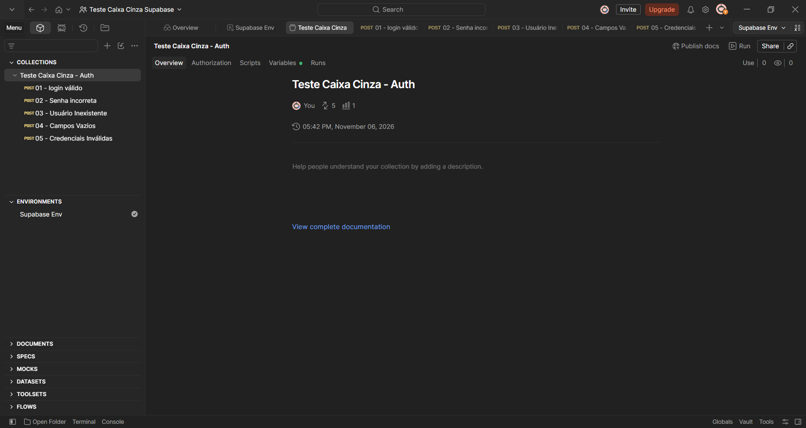

---

# Configuração das Requisições

## Endpoint e método

| Item | Valor |
|---|---|
| Método HTTP | `POST` |
| Endpoint | `{{base_url}}/auth/v1/token?grant_type=password` |

O parâmetro `grant_type=password` indica ao Supabase que o login é feito com e-mail e senha.

## Headers utilizados

| Header | Valor |
|---|---|
| `apikey` | `XXXXX` (valor da variável `{{api_key}}`) |
| `Authorization` | `Bearer XXXXX` (valor da variável `{{api_key}}`) |
| `Content-Type` | `application/json` |

No Postman, os valores reais são preenchidos com `{{api_key}}`.

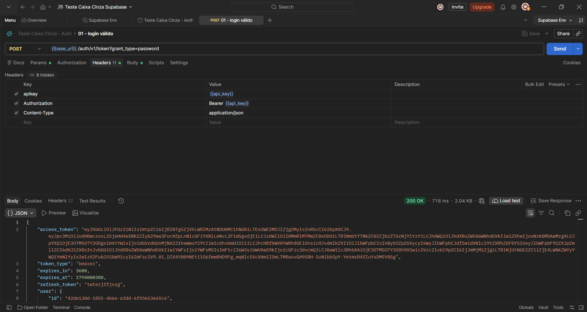

## Body JSON utilizado

Exemplo genérico:

```json
{
  "email": "usuario@email.com",
  "password": "123456"
}
```

Body configurado no Postman, com variáveis do Environment:

```json
{
  "email": "{{email}}",
  "password": "{{password}}"
}
```

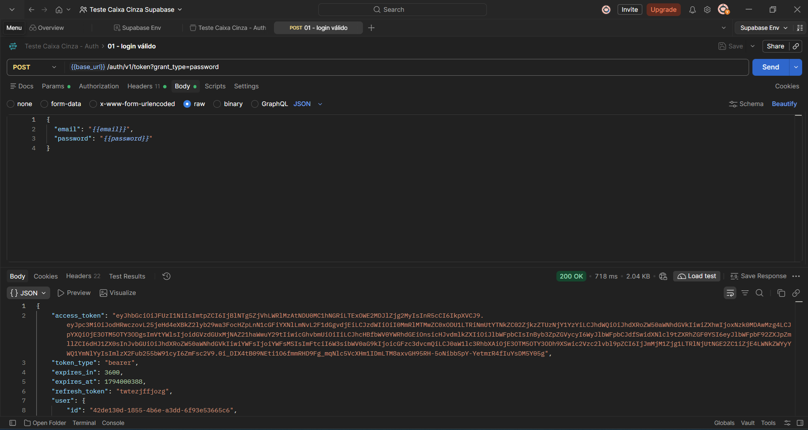

## Finalidade da requisição

Autenticar um usuário no Supabase. Com credenciais válidas, a API devolve um **access token** (JWT). Com credenciais inválidas, devolve um erro. Esse comportamento é o que os testes verificam.

---

# Execução dos Testes

Executei cinco cenários, todos pela requisição `POST /auth/v1/token?grant_type=password`. Em cada um, alterei apenas o body.

## Tabela de cenários

| Cenário | Entrada Utilizada | Resultado Esperado | Resultado Obtido | Status |
|---|---|---|---|---|
| Login válido | `teste123@gmail.com` + senha correta | Status 200 + access token | 200 OK, com `access_token`, `refresh_token` e dados do usuário | OK |
| Senha incorreta | `teste123@gmail.com` + `senhaErrada999` | Erro de autenticação | 400, `invalid_credentials`, "Invalid login credentials" | OK |
| Usuário inexistente | `naoexiste@teste.com` + senha correta | Acesso negado | 400, `invalid_credentials`, "Invalid login credentials" | OK |
| Campos vazios | `""` e `""` | Erro de validação | 400, `validation_failed`, "missing email or phone" | OK |
| Credenciais inválidas | `abc` e `1` | Mensagem de erro | 400, `invalid_credentials`, "Invalid login credentials" | OK |

## Cenário 1: Login válido

Foi retornado **200 OK** com o `access_token` (JWT), `token_type: "bearer"`, `expires_in: 3600` (1 hora), `refresh_token` e os dados do usuário.

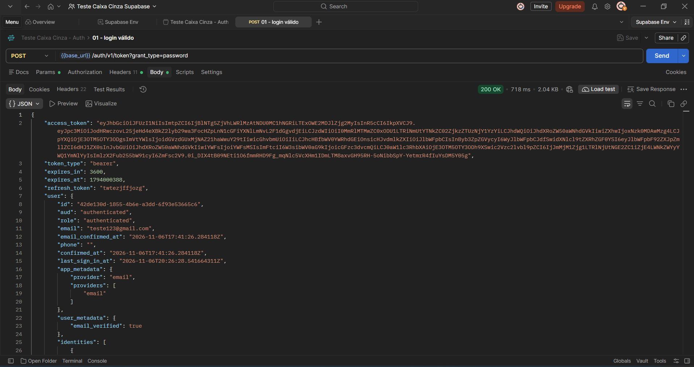

## Cenário 2: Senha incorreta

O e-mail estava correto e a senha errada. A API respondeu **400 Bad Request** com `invalid_credentials` e nenhum token.

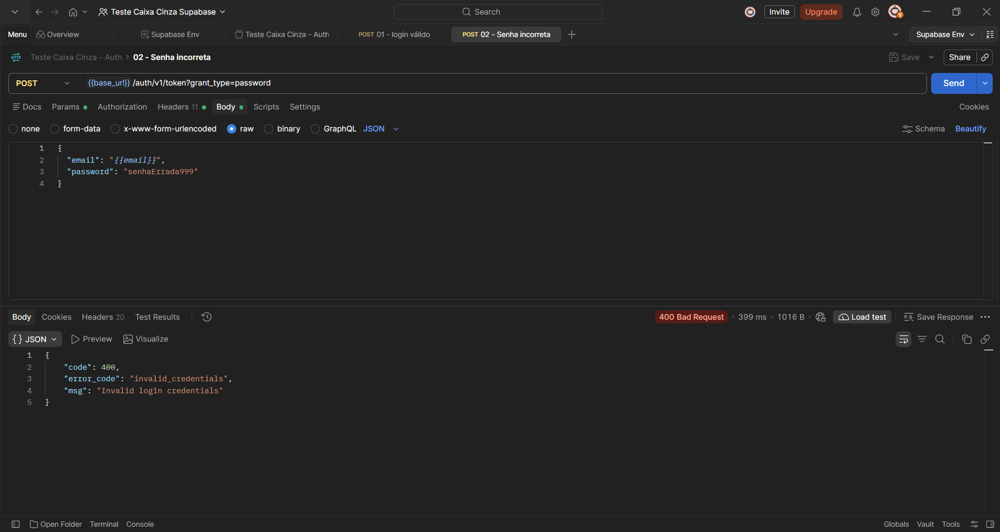

## Cenário 3: Usuário inexistente

Com um e-mail não cadastrado, a resposta foi igual à do cenário 2: **400**, `invalid_credentials`. O Supabase não revela se o e-mail existe, o que evita que alguém descubra quais usuários estão cadastrados.

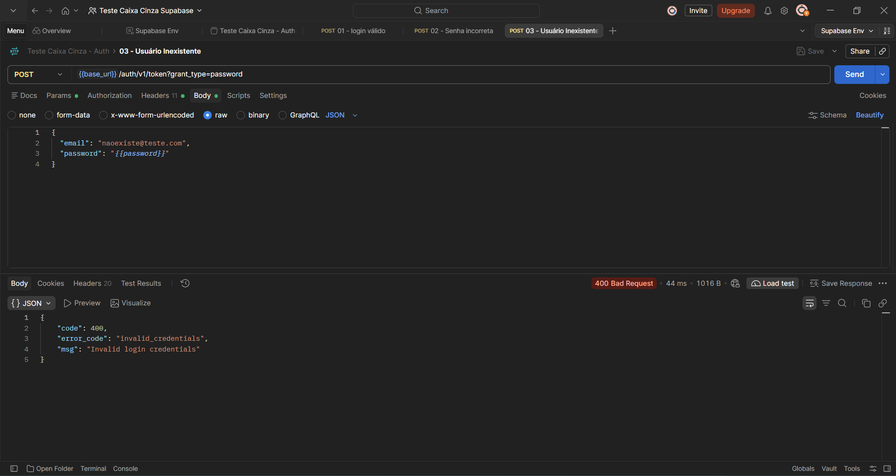

## Cenário 4: Campos vazios

Com e-mail e senha vazios, a resposta foi um erro de validação diferente: **400**, `validation_failed`, "missing email or phone". A resposta foi mais rápida (57 ms), indicando que a validação ocorre antes da checagem das credenciais.

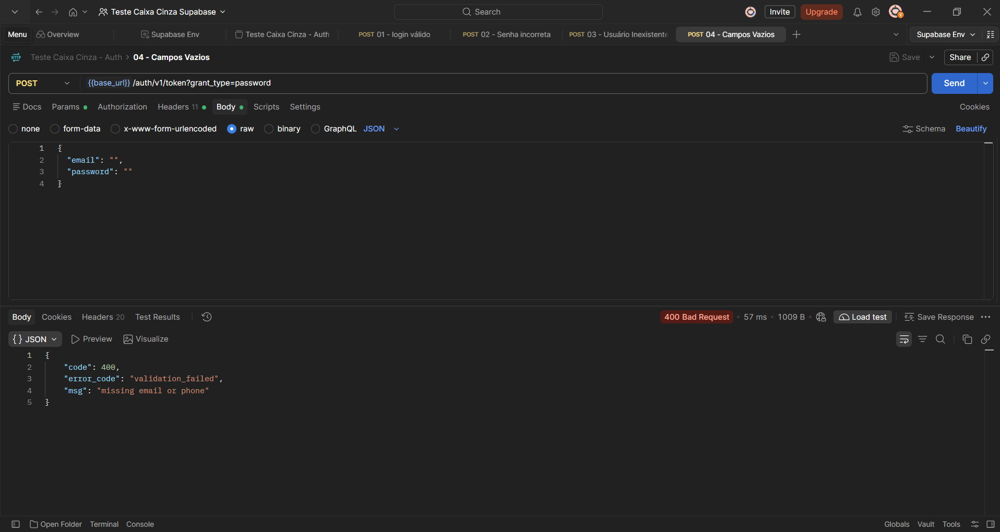

## Cenário 5: Credenciais inválidas

Com `abc` como e-mail e `1` como senha, a API respondeu **400**, `invalid_credentials`. O formato do e-mail não é validado separadamente: a API devolve a mesma mensagem genérica.

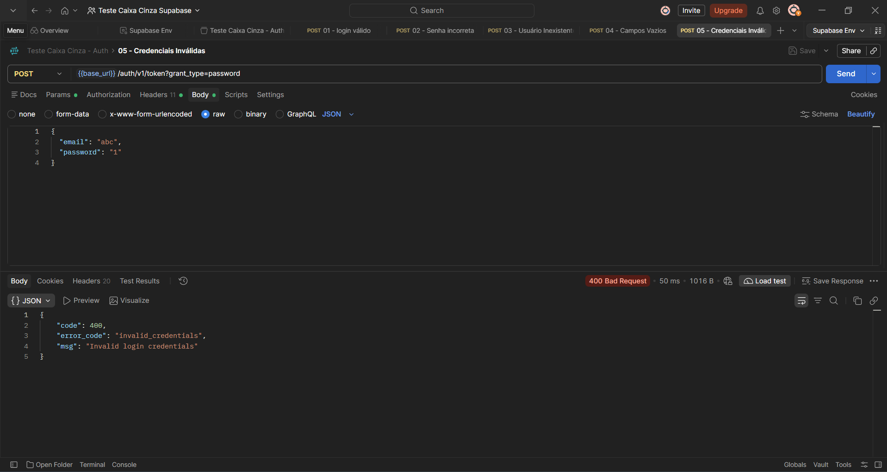

## Erros encontrados durante a execução

- **Erro de configuração na primeira tentativa:** o primeiro envio retornou **401 Unauthorized** com a mensagem "No API key found in request". Eu havia colocado `apikey`, `Authorization` e `Content-Type` na aba **Params** (como parâmetros da URL), em vez de **Headers**. Movi para a aba correta, e a requisição passou a retornar 200.
- **Header `Authorization` incorreto:** o Postman gerou automaticamente uma variável inexistente (`{{bearer_token_...}}`). Troquei o valor por `Bearer {{api_key}}`.
- **Falhas da API:** nenhum cenário apresentou comportamento diferente do esperado.

---

# Registro dos Testes

## Como os testes foram registrados

Registrei os testes em uma planilha baseada no modelo fornecido na aula, com três abas:

- **INFORMATIVO:** dados do projeto, ambiente (Windows 11, Dell Inspiron 15 3530, Postman Desktop e Supabase), responsável e histórico de revisões;
- **SISTEMA:** os cinco cenários, com ID, cenário, funcionalidade, execução, entrada, resultado esperado, resultado obtido, status e observações;
- **ACEITAÇÃO:** os requisitos de autenticação e seus riscos.

Arquivo: [`planilha/planilha-testes-caixa-cinza.xlsx`](planilha/planilha-testes-caixa-cinza.xlsx)

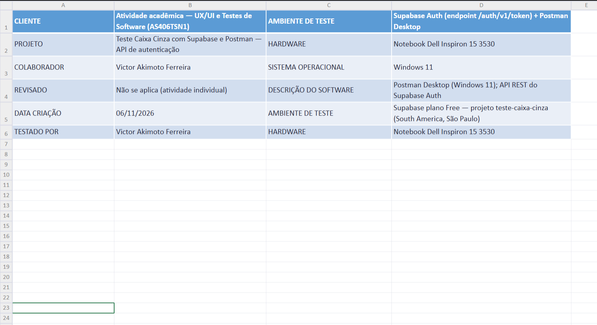

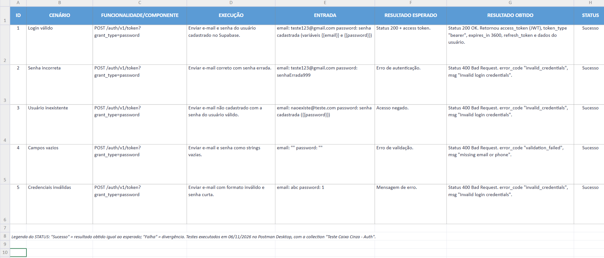

### Exemplo de registro (cenário 2)

| Campo | Valor |
|---|---|
| ID | 2 |
| Cenário | Senha incorreta |
| Entrada | `teste123@gmail.com` / `senhaErrada999` |
| Resultado esperado | Erro de autenticação |
| Resultado obtido | 400, `invalid_credentials`, "Invalid login credentials" |
| Status | Sucesso |
| Observações | Acesso bloqueado; nenhum token retornado |

## Importância da documentação dos testes

Registrar entradas, resultados esperados e obtidos permite repetir os testes, comparar versões e provar o que foi verificado. Também ajuda outras pessoas a entender o comportamento do sistema e facilita encontrar a origem de uma falha.

## Falhas identificadas

Nenhum cenário falhou: em todos, o resultado obtido foi o esperado. Identifiquei apenas pontos de melhoria na API, descritos na conclusão.

---

# Resultados Obtidos

| Cenário | Status HTTP | `error_code` | Mensagem | Tempo de resposta |
|---|---|---|---|---|
| Login válido | 200 OK | — | access token retornado | 718 ms |
| Senha incorreta | 400 Bad Request | `invalid_credentials` | Invalid login credentials | 399 ms |
| Usuário inexistente | 400 Bad Request | `invalid_credentials` | Invalid login credentials | 44 ms |
| Campos vazios | 400 Bad Request | `validation_failed` | missing email or phone | 57 ms |
| Credenciais inválidas | 400 Bad Request | `invalid_credentials` | Invalid login credentials | 50 ms |

**Resumo:** os 5 cenários foram executados e todos tiveram o comportamento esperado (5 de 5). A autenticação aceitou as credenciais válidas, rejeitou as inválidas e retornou o token apenas no login correto.

Os arquivos exportados do Postman estão em `/postman/`:
- [`postman/colecao-auth-supabase.json`](postman/colecao-auth-supabase.json) (collection)
- [`postman/environment-supabase.json`](postman/environment-supabase.json) (environment)

---

# Conclusão

**Os testes foram executados corretamente?** Sim. Executei os cinco cenários obrigatórios no Postman Desktop, com evidências reais de cada um e registro na planilha.

**A autenticação funcionou?** Sim. O login válido retornou 200 e um access token (válido por 1 hora). Senha incorreta, usuário inexistente, campos vazios e credenciais inválidas retornaram erro 400 e nenhum token.

**Dificuldades encontradas**
- Coloquei os headers na aba Params em vez de Headers, o que causou o erro 401 inicial.
- O Postman criou uma variável automática no header `Authorization`, que precisei corrigir.
- Em alguns momentos, o painel de collections do Postman não exibia os itens, e precisei recarregar a janela.
- Abri o Postman primeiro no navegador, e depois passei para o aplicativo Desktop, como a atividade exige.

**Falhas e limitações identificadas**
- Senha incorreta, usuário inexistente e credenciais inválidas retornam a mesma mensagem genérica. Isso é bom para a segurança, mas dá pouca orientação ao usuário.
- A API não valida o formato do e-mail, e com `abc` devolve o mesmo erro de credenciais.
- Na validação de campos vazios, a mensagem cita apenas o e-mail ausente.

**Melhorias que poderiam ser implementadas**
- Mensagens específicas de validação (formato do e-mail, tamanho mínimo da senha), exibidas no front-end antes do envio.
- Limite de tentativas de login (rate limit) e autenticação em dois fatores.
- Ativar a confirmação de e-mail em um ambiente real.
- Automatizar as verificações com scripts na aba de testes do Postman e executar a collection inteira com o **Run**.

**Importância dos testes de caixa cinza em APIs**
Eles permitem validar o comportamento da API sem acessar o código-fonte, usando o conhecimento de endpoint, headers, body e respostas. Assim é possível encontrar falhas de autenticação e de validação cedo, antes da interface, e conferir se erros não vazam informações sensíveis. Também servem de base para testes automatizados e de regressão.
